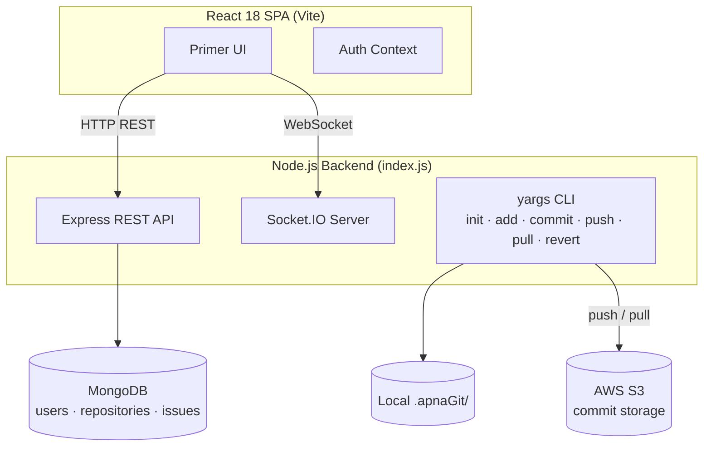
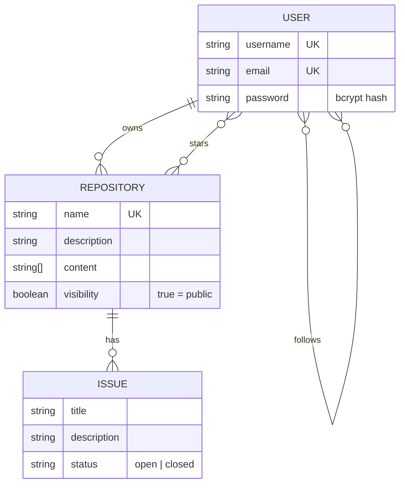

<div align="center">

# 🐙 GitHub Clone

### A MERN-stack GitHub replica with a version control system built from scratch.

Manage users, repositories and issues through a GitHub-styled UI, and version your files with a custom Git-like CLI (`init`, `add`, `commit`, `push`, `pull`, `revert`) that uses **AWS S3** as its remote.

<p>
  
  
  
  
  
  
  
</p>

[**Features**](#-features) · [**Version Control CLI**](#-custom-version-control-cli) · [**Quick Start**](#-quick-start) · [**API Reference**](#-api-reference) · [**Roadmap**](#-roadmap)

</div>

---

## 📸 Screenshots

<div align="center">

<!-- Add screenshots of: Login, Dashboard, Profile with heatmap -->
<!--  -->

</div>

---

## ✨ Features

- 👤 **User management**: sign up, log in, view and update profiles
- 📦 **Repository management**: create, list, search, update and delete repos, and toggle public/private visibility
- 🐞 **Issue tracking**: create, update, close and delete issues per repository
- 🛠️ **Custom version control CLI**: a Git-like workflow built with Node.js `fs` and AWS S3, no Git involved
- ⚡ **Real-time events**: Socket.IO rooms for per-user live notifications
- 🟩 **Activity heatmap**: GitHub-style contribution calendar on user profiles
- 🎨 **Authentic UI**: built with GitHub's own Primer design system

---

## 🧰 Tech Stack

| Layer | Technology |
|---|---|
| Frontend | React 18, Vite, React Router v6, Axios, `@primer/react`, `@uiw/react-heat-map` |
| Backend | Node.js, Express |
| Database | MongoDB with Mongoose (native driver in the user controller) |
| Auth | JWT (`jsonwebtoken`) + `bcryptjs` password hashing |
| Real-time | Socket.IO |
| Storage | AWS S3 (`aws-sdk` v2) |
| CLI | `yargs`, `uuid` |

---

## 🏗️ Architecture



### One entry point, two modes

`backend-main/index.js` uses `yargs` to act as both a web server and a CLI tool:

| Command | Mode |
|---|---|
| `node index.js start` | Starts Express, Socket.IO and the MongoDB connection |
| `node index.js <command>` | Runs a local version control command |

---

## 🧬 Custom Version Control CLI

A Git-inspired system built from scratch. Local state lives in a hidden `.apnaGit/` folder, and AWS S3 plays the role of the remote.

```
.apnaGit/
├── config.json          # S3 bucket name
├── staging/             # files added, not yet committed
└── commits/
    └── <uuid>/          # one folder per commit
        ├── <files…>     # snapshot of the staged files
        └── commit.json  # { message, date }
```

| Command | Git equivalent | What it does |
|---|---|---|
| `node index.js init` | `git init` | Creates `.apnaGit/` with its `commits/` folder and `config.json` |
| `node index.js add <file>` | `git add` | Copies the file into `.apnaGit/staging/` |
| `node index.js commit "<message>"` | `git commit` | Generates a UUID, snapshots all staged files into `commits/<uuid>/`, and writes `commit.json` |
| `node index.js push` | `git push` | Uploads every commit folder to S3 under `commits/<commitID>/<filename>` |
| `node index.js pull` | `git pull` | Lists objects under `commits/` in S3 and downloads them locally |
| `node index.js revert <commitID>` | `git checkout <commit>` | Copies that commit's files back into the project root |

### Example workflow

```bash
node index.js init
node index.js add src/app.js
node index.js commit "Initial commit"
node index.js push

# on another machine
node index.js init
node index.js pull
node index.js revert <commit-uuid>
```

> S3 has a flat namespace, so `commits/<commitID>/<filename>` is simply a key. The `/` only looks like a folder in tooling.

---

## 🗄️ Data Model



Relationships use **ObjectId references** and Mongoose `populate()` (for example `Repository.find({}).populate("owner").populate("issues")`) rather than embedded documents.

---

## 🚀 Quick Start

### Prerequisites

- **Node.js** (v18 or later recommended)
- A **MongoDB** instance: local or [MongoDB Atlas](https://www.mongodb.com/atlas)
- An **AWS account** with an S3 bucket (only needed for `push` and `pull`)

### 1. Clone and install

```bash
git clone <your-repo-url>
cd <your-repo-name>

cd backend-main && npm install
cd ../frontend-main && npm install
```

### 2. Configure the backend

Create `backend-main/.env`:

```env
PORT=3002
MONGODB_URI=mongodb://localhost:27017/githubclone
JWT_SECRET_KEY=replace-with-a-long-random-string

# Used automatically by the AWS SDK
AWS_ACCESS_KEY_ID=your-access-key
AWS_SECRET_ACCESS_KEY=your-secret-key
```

Then set your bucket name in `backend-main/config/aws-config.js`:

```javascript
const S3_BUCKET = "your-bucket-name";
```

### 3. Run the app

```bash
# Terminal 1: backend (REST API + Socket.IO)
cd backend-main
node index.js start

# Terminal 2: frontend (Vite, port 5173)
cd frontend-main
npm run dev
```

Open **http://localhost:5173**.

### 4. Use the CLI

Run the version control commands from the folder you want to track. See [Custom Version Control CLI](#-custom-version-control-cli).

---

## 📁 Project Structure

```
backend-main/
├── index.js              # Entry point: server OR CLI
├── config/
│   └── aws-config.js     # S3 client setup
├── controllers/
│   ├── userController.js
│   ├── repoController.js
│   ├── issueController.js
│   ├── init.js  add.js  commit.js  push.js  pull.js  revert.js   # CLI commands
├── middleware/           # auth + authorize (placeholders)
├── models/               # userModel, repoModel, issueModel
└── routes/               # main, user, repo, issue routers

frontend-main/src/
├── main.jsx              # App entry
├── Routes.jsx            # Routes + auth guard
├── authContext.jsx       # Auth state (Context API)
└── components/
    ├── Navbar.jsx
    ├── auth/             # Login, Signup
    ├── dashboard/        # Dashboard (repos + search)
    └── user/             # Profile, HeatMap
```

---

## 📡 API Reference

**Base URL:** `http://localhost:3002/`

### Users

| Method | Route | Description |
|---|---|---|
| GET | `/allUsers` | List all users |
| POST | `/signup` | Register and receive `{ token, userId }` |
| POST | `/login` | Authenticate and receive `{ token, userId }` |
| GET | `/userProfile/:id` | Get a user profile |
| PUT | `/updateProfile/:id` | Update email or password |
| DELETE | `/deleteProfile/:id` | Delete an account |

### Repositories

| Method | Route | Description |
|---|---|---|
| POST | `/repo/create` | Create a repository |
| GET | `/repo/all` | List all repositories (owner and issues populated) |
| GET | `/repo/:id` | Get by ID |
| GET | `/repo/name/:name` | Get by name |
| GET | `/repo/user/:userID` | Get all repos owned by a user |
| PUT | `/repo/update/:id` | Append content or update the description |
| DELETE | `/repo/delete/:id` | Delete a repository |
| PATCH | `/repo/toggle/:id` | Toggle public/private visibility |

### Issues

| Method | Route | Description |
|---|---|---|
| POST | `/issue/create` | Create an issue |
| GET | `/issue/all` | List all issues |
| GET | `/issue/:id` | Get an issue |
| PUT | `/issue/update/:id` | Update title, description or status |
| DELETE | `/issue/delete/:id` | Delete an issue |

---

## 🔐 Authentication

- **Signup and login** hash and verify passwords with `bcryptjs` (cost factor 10) and return a **JWT** (`expiresIn: 1h`) signed with `JWT_SECRET_KEY`.
- The frontend stores `token` and `userId` in `localStorage`, and a route guard in `Routes.jsx` redirects unauthenticated users to `/auth`.
- **Real-time:** a client emits `joinRoom` with its `userID`, and the server can push to that user with `io.to(userID).emit(...)`.

---

## 🎓 What I Learned

- Designing a **dual-mode Node.js app** (web server and CLI) from a single entry point with `yargs`
- Modelling Git concepts (staging area, commit snapshots, remotes) with plain file operations and S3 object keys
- Structuring a REST API with the **MVC pattern**, Mongoose references and `populate()`
- Implementing **JWT auth** and bcrypt hashing, and understanding the trade-offs of `localStorage` vs `HttpOnly` cookies
- Building real-time features with **Socket.IO rooms**
- Managing global state with React's **Context API**

---

## 🗺️ Roadmap

- [x] User, repository and issue management
- [x] Custom CLI: `init`, `add`, `commit`, `push`, `pull`, `revert`
- [x] Socket.IO room system
- [x] Activity heatmap on profiles
- [ ] JWT verification middleware to protect routes
- [ ] Restrict CORS to the frontend origin
- [ ] Clear the staging area after each commit
- [ ] Real follower/following counts and real heatmap activity data
- [ ] Fix issue creation route to include the repository ID (`/issue/:repoId/create`)
- [ ] Branching, diffs and content-hash commit IDs
- [ ] Migrate to AWS SDK v3
- [ ] Rate limiting and input sanitisation

---

## 👩‍💻 Author

**Jahnvi Verma**, B.Tech CSE at VIT Bhopal · Project Intern at FOSSEE, IIT Bombay

[](https://github.com/verma-jaanvi)
[](https://www.linkedin.com/in/your-handle)

<div align="center">

⭐ If you found this project useful, consider giving it a star.

</div>
